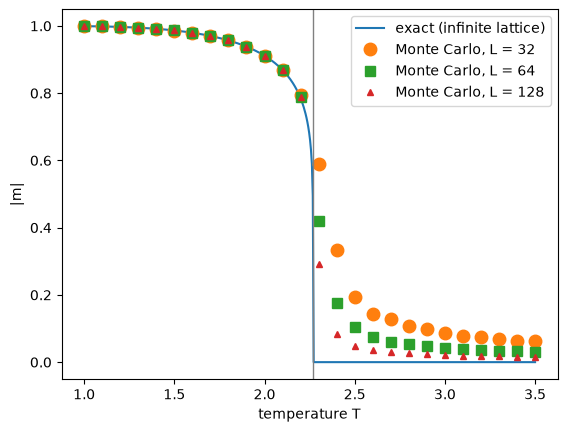
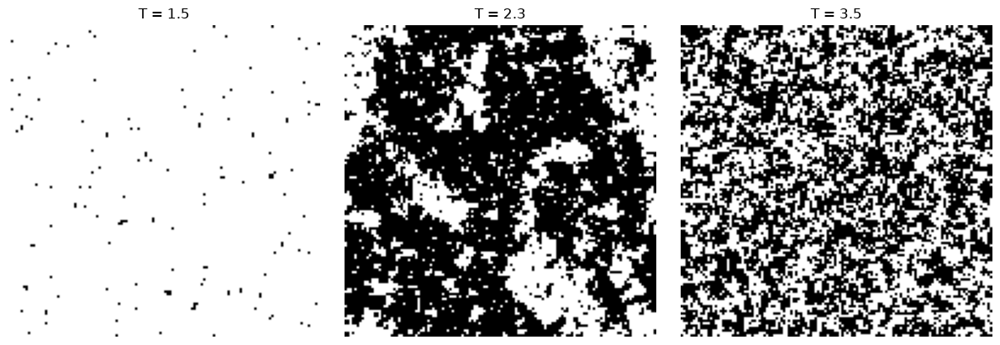

# 2D Ising model with Metropolis Monte Carlo

A Monte Carlo simulation of the two-dimensional Ising model on an L × L lattice with periodic boundaries. It reproduces Onsager's exact magnetisation below the critical temperature T_c ≈ 2.269 and shows how finite-size effects shrink as the lattice grows.

Everything is in one notebook, [`Ising2d.ipynb`](Ising2d.ipynb), with an explanation before each step.

## Results



Below T_c all three lattice sizes match the exact curve. Above T_c a finite lattice keeps a small magnetisation, which halves each time L doubles:

| T | L = 32 | L = 64 | L = 128 | exact (infinite lattice) |
|---|---|---|---|---|
| 2.0 | 0.911 | 0.911 | 0.911 | 0.911 |
| 2.2 | 0.795 | 0.790 | 0.788 | 0.785 |
| 2.3 | 0.590 | 0.421 | 0.292 | 0 |
| 2.4 | 0.332 | 0.175 | 0.084 | 0 |
| 2.5 | 0.195 | 0.104 | 0.049 | 0 |

Snapshots of a 128 × 128 lattice below, just above, and well above T_c (white = +1, black = −1):



## How it works

- **Model.** Spins s = ±1 with energy E = −J Σ s_i s_j over nearest-neighbour pairs, J = 1, k_B = 1.
- **Metropolis update.** A flip changes the energy by ΔE = 2J s_i n_i, where n_i is the sum of the four neighbours. It is accepted with probability min(1, e^(−ΔE/T)).
- **Checkerboard decomposition.** Sites are coloured by the parity of i + j, so no two sites of the same colour are neighbours. All sites of one colour are then updated at once with NumPy, without a Python loop over sites. This requires an even L.
- **Temperature scan.** 26 temperatures from 1.0 to 3.5. The lattice starts with all spins up at T = 1.0 and is carried over from each temperature to the next. At each temperature, the first sweeps are discarded (equilibration) and |m| is averaged over the rest. Larger lattices use more sweeps, because their correlated clusters near T_c change more slowly.

## Running it

Requirements: Python 3.8 or newer, NumPy, Matplotlib and Jupyter.

```bash
pip install numpy matplotlib jupyter
jupyter notebook Ising2d.ipynb
```

The whole notebook runs in about 5 minutes; most of that is the L = 128 scan. The random number generator is seeded, so the results are reproducible.

## Limitations

- The averages have no error bars. Consecutive sweeps are correlated, most strongly near T_c, so the point at T = 2.3 is the least certain one (about ±0.03 to ±0.04 for the larger lattices).
- Single-spin Metropolis slows down near T_c. Cluster algorithms such as Wolff or Swendsen–Wang would be faster there.

## References

- L. Onsager, *Crystal statistics. I. A two-dimensional model with an order-disorder transition*, Phys. Rev. **65**, 117 (1944).
- C. N. Yang, *The spontaneous magnetization of a two-dimensional Ising model*, Phys. Rev. **85**, 808 (1952).
- N. Metropolis, A. W. Rosenbluth, M. N. Rosenbluth, A. H. Teller and E. Teller, *Equation of state calculations by fast computing machines*, J. Chem. Phys. **21**, 1087 (1953).
